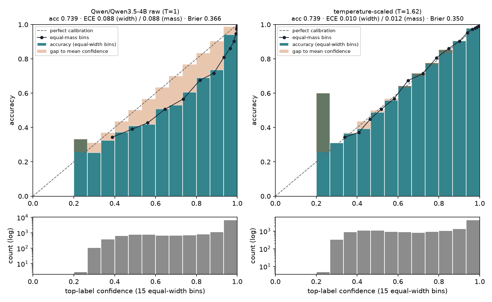
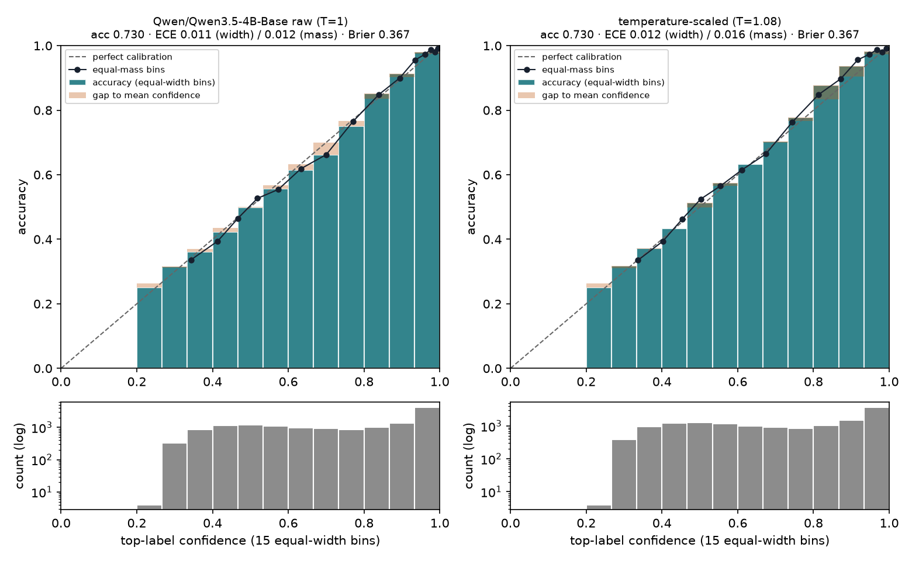

# llm-calibration

How far can you trust the confidence of an open LLM when it picks an answer?

This repository measures that on MMLU (14,042 multiple-choice questions) for Qwen3.5-4B, in its
base form and after chat post-training. The model scores the answer letters in one forward
pass, and the softmax over those four letters is its confidence.

## What we found

Post-training made the model overconfident while leaving its accuracy almost unchanged.

| Model | Accuracy | Mean confidence | Calibration error (ECE) | After temperature scaling |
|---|---|---|---|---|
| Qwen3.5-4B-Base | 73.0 % | 73.4 % | 0.011 | 0.012 |
| Qwen3.5-4B (chat) | 73.9 % | 82.6 % | 0.088 | 0.010 |

The chat model is right about 74 % of the time but says it is 83 % sure on average. The base
model's confidence matches its accuracy almost exactly. One temperature (T = 1.62), fitted on
the 1,531 validation questions, brings the chat model back to the base model's level. Ranking
quality hardly moves: the AUROC for telling right from wrong answers is 0.83 for both.

| Qwen3.5-4B (chat) | Qwen3.5-4B-Base |
|---|---|
|  |  |

A well-calibrated model sits on the diagonal. Every number in the tables comes from
`results/<run>/metrics.json`, which also holds 95 % bootstrap intervals.

## How it is measured

- **Scoring.** The prompt ends where the answer letter goes. Chat models get their chat
  template with thinking switched off and the reply pre-filled with `Answer:`. Base models get
  the plain MMLU completion format. Each option's score is the log-sum-exp of the `X` and ` X`
  tokens.
- **Calibration.** The temperature is fitted on MMLU validation by minimising NLL, and every
  metric is reported on test. ECE uses the top label and 15 bins, with both equal-width and
  equal-mass bins. Brier score, NLL and AUROC are reported too.
- **Batching check.** A few test items are re-scored one at a time. In fp32, left-padded
  batches match single-item scores to 0.001. bf16 adds up to about 0.05 of noise per item.

## Run it

Python 3.12 with [uv](https://docs.astral.sh/uv/). The torch wheels target CUDA 12.8.

```bash
uv sync                      # creates .venv from uv.lock
uv run pytest -q             # tests for the calibration metrics (CPU)

# full MMLU baseline on one GPU, both models
CUDA_VISIBLE_DEVICES=0 bash scripts/run_mmlu_gpu.sh

# quick CPU check with a small model and 40 items per split
uv run python scripts/mmlu_baseline.py --model Qwen/Qwen3.5-0.8B \
  --device cpu --limit 40 --batch-size 8 --check-batch 8 --out results/smoke_cpu
```

## Layout

| Path | What it holds |
|---|---|
| `src/llmlab/calibration.py` | accuracy, NLL, Brier, ECE (equal-width and equal-mass), AUROC, bootstrap intervals, temperature scaling |
| `src/llmlab/mcq.py` | zero-shot option scoring from the answer-letter logits |
| `src/llmlab/plots.py` | reliability diagrams |
| `scripts/mmlu_baseline.py` | scores validation and test, fits the temperature, writes the metrics |
| `scripts/check_batching.py` | separates bf16 rounding from left-padding effects |
| `results/<run>/` | metrics, reliability diagram, example prompts and the commit each run used |

## Next

Calibration on MMLU is the easy case: four fixed options and a large validation set. The next
step is decisions where the options change from question to question and only a handful of
labelled examples exist.

Nirwan Banerjee · [LinkedIn](https://www.linkedin.com/in/nirwan-banerjee-835a9a18b)
